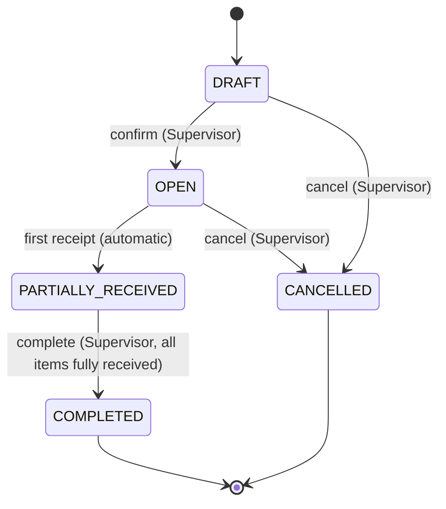

# Product Requirements Document: Warehouse Receiving System

| | |
|---|---|
| **Version** | 1.0 |
| **Status** | Draft for implementation |
| **Audience** | Developers and AI coding agents implementing the system; reviewers |
| **Related documents** | `technical-spec.md`, `openapi.yaml`, `erd.mmd`, `data-flow.mmd` |

> **How to read this document.** Every requirement has a stable ID (`FR-`, `NFR-`, `BR-`, `US-`). Technical documents and tests must reference these IDs. Where the original business request was unclear, the decision taken is recorded in Section 9 (Assumptions) and marked with an `A-` ID. An implementer must follow these decisions and must not invent behavior that is not described here. If something is missing, record it as a question in Section 11 rather than guessing.

---

## 1. Problem Statement and Business Objectives

### 1.1 Problem statement

The warehouse currently records incoming inventory in spreadsheets. This causes the following problems:

- Quantities are typed by hand and can be wrong, duplicated, or overwritten.
- There is no enforced link between what was expected from a delivery and what was actually received, so over-receiving goes unnoticed.
- There is no reliable history of who received what and when.
- Stock levels are only as accurate as the last person who edited the sheet.
- Partial deliveries are hard to track, so it is unclear whether a delivery is finished.

### 1.2 Business objectives

| ID | Objective | Measure of success |
|---|---|---|
| OBJ-1 | Replace spreadsheets with a single system of record for inbound deliveries. | All inbound deliveries are registered as receiving documents. |
| OBJ-2 | Make received quantities accurate and traceable. | Every stock change has a transaction record with user, time, and document reference. |
| OBJ-3 | Prevent over-receiving and premature completion. | The system rejects 100% of receipts above the remaining expected quantity and 100% of completion attempts on documents that are not fully received. |
| OBJ-4 | Keep stock correct under mistakes and repeated requests. | Stock on hand always equals the sum of its transactions, even after duplicate submissions or concurrent requests. |
| OBJ-5 | Give supervisors visibility. | Supervisors can see document status, per-item progress, current stock, and transaction history at any time. |

---

## 2. User Roles and Responsibilities

There are two roles. A user has exactly one role (A-02). Users are created by a seeding process, not through the UI (A-03).

### 2.1 Warehouse Operator

Works on the receiving dock and records what physically arrives.

| Responsibility | Permitted |
|---|---|
| Log in and out | Yes |
| View products | Yes |
| View receiving documents and their items | Yes |
| **Record received quantities** against an item of an open document | Yes |
| View inventory and transaction history | Yes |
| Create products | No |
| Create or edit receiving documents | No |
| Confirm, complete, or cancel receiving documents | No |

### 2.2 Warehouse Supervisor

Plans inbound deliveries and is accountable for their completion.

| Responsibility | Permitted |
|---|---|
| Everything the Operator can do | Yes |
| **Create products** | Yes |
| **Create receiving documents** with items and expected quantities | Yes |
| Edit items of a document while it is in `DRAFT` | Yes |
| **Confirm** a draft document (`DRAFT` to `OPEN`) | Yes |
| **Complete** a document that is fully received | Yes |
| **Cancel** a document that has no receipts | Yes |

The full permission matrix is in Section 8.4.

---

## 3. Glossary

| Term | Meaning |
|---|---|
| **Product** | A stock-keeping item identified by a unique SKU. |
| **SKU** | Stock Keeping Unit code, the unique business identifier of a product. |
| **Receiving document** | A record of one expected inbound delivery. It contains one or more items. |
| **Item (receiving item)** | One product line in a receiving document, with an expected quantity and a received quantity. |
| **Expected quantity** | Quantity the supplier is supposed to deliver for an item. |
| **Received quantity** | Total quantity already recorded as received for an item. |
| **Remaining quantity** | Expected quantity minus received quantity. |
| **Receipt** | A single act of recording a received quantity for one item. An item can have many receipts (partial receipts). |
| **Fully received item** | An item whose received quantity equals its expected quantity. |
| **Fully received document** | A document where every item is fully received. |
| **Stock on hand** | Total quantity of a product currently in the warehouse. |
| **Inventory transaction** | An immutable ledger entry describing one change to stock on hand. |
| **Idempotency key** | A client-generated unique value sent with a receipt request so that repeating the same request never records it twice. |

---

## 4. Application Scope

### 4.1 In scope

1. Authentication and role-based access control for Operators and Supervisors.
2. Product management: create and list products with unique SKU codes.
3. Receiving documents: create, list, view detail, edit items while in draft.
4. Receiving document lifecycle: confirm, receive, complete, cancel.
5. Recording partial and full receipts per item.
6. Automatic stock updates when a receipt is recorded.
7. Inventory view: current stock per product.
8. Inventory transaction history.
9. Backend enforcement of all business rules, independent of the frontend.
10. A web user interface for the main workflows.
11. REST API with documented contract.
12. Containerized, reproducible deployment with health check.

### 4.2 Out of scope

The following are explicitly **not** to be built:

- Outbound movements (shipping, picking, sales) and any stock decrease.
- Stock adjustments, corrections, and cycle counts.
- Reversal or cancellation of a recorded receipt.
- Over-receiving with tolerance, short-closing, damaged or rejected goods handling.
- Multiple warehouses, locations, bins, or racks.
- Batch, lot, serial number, or expiry date tracking.
- Supplier master data, purchase orders, and purchase order matching.
- Product edit, deactivate, or delete.
- User registration, password reset, user management UI, and social login.
- Reports, exports, dashboards, charts, and notifications.
- Barcode or QR scanning, label printing.
- Units of measure and unit conversion.
- Multi-language user interface and localization.
- Audit log of non-stock events (for example, who viewed a document).

---

## 5. Functional Requirements

### 5.1 Authentication and authorization

| ID | Requirement |
|---|---|
| FR-AUTH-1 | The system shall allow a user to log in with email and password and receive an access token. |
| FR-AUTH-2 | The system shall allow a logged-in user to log out, which invalidates the current token. |
| FR-AUTH-3 | The system shall provide an endpoint returning the current user's id, name, email, and role. |
| FR-AUTH-4 | All endpoints except login and health check shall require authentication. |
| FR-AUTH-5 | The backend shall check the user's role on every protected action and respond with 403 when the role is not permitted. |
| FR-AUTH-6 | The system shall provide seeded demo accounts: one Operator and one Supervisor. Credentials shall come from environment variables or documented demo values that are not production secrets. |

### 5.2 Products

| ID | Requirement |
|---|---|
| FR-PROD-1 | A Supervisor shall be able to create a product with SKU and name. |
| FR-PROD-2 | The system shall reject creation of a product whose SKU already exists (case-insensitive). |
| FR-PROD-3 | All authenticated users shall be able to list products with pagination and search by SKU or name. |
| FR-PROD-4 | All authenticated users shall be able to view one product by id. |
| FR-PROD-5 | Creating a product shall automatically create its inventory record with stock on hand of 0. |

### 5.3 Receiving documents

| ID | Requirement |
|---|---|
| FR-DOC-1 | A Supervisor shall be able to create a receiving document with supplier name, expected arrival date, optional notes, and one or more items. |
| FR-DOC-2 | The system shall generate a unique document number in the format `RCV-YYYYMMDD-NNNN` (A-10). |
| FR-DOC-3 | A new document shall start in status `DRAFT`. |
| FR-DOC-4 | Each item shall reference an existing product and have an expected quantity. |
| FR-DOC-5 | A product shall appear at most once in a document. |
| FR-DOC-6 | While in `DRAFT`, a Supervisor shall be able to edit header fields and add, change, or remove items. |
| FR-DOC-7 | After leaving `DRAFT`, header fields and items shall be read-only, except for received quantities, which change only through receipts. |
| FR-DOC-8 | All authenticated users shall be able to list receiving documents with pagination, filtered by status, and searched by document number or supplier. |
| FR-DOC-9 | All authenticated users shall be able to view a document with its header, status, and all items including expected, received, and remaining quantities. |
| FR-DOC-10 | The document detail shall show the receipt history (each receipt with quantity, user, and time). |

### 5.4 Document lifecycle

| ID | Requirement |
|---|---|
| FR-LIFE-1 | A Supervisor shall be able to **confirm** a `DRAFT` document that has at least one item. Status becomes `OPEN`. |
| FR-LIFE-2 | When the first receipt is recorded on an `OPEN` document, the system shall automatically change its status to `PARTIALLY_RECEIVED`. |
| FR-LIFE-3 | A Supervisor shall be able to **complete** a `PARTIALLY_RECEIVED` document only if every item is fully received. Status becomes `COMPLETED`. |
| FR-LIFE-4 | A Supervisor shall be able to **cancel** a document in `DRAFT` or `OPEN` status. Status becomes `CANCELLED`. |
| FR-LIFE-5 | `COMPLETED` and `CANCELLED` are final. No further changes or receipts are allowed. |
| FR-LIFE-6 | Any status change not listed in Section 8.3 shall be rejected with a conflict error. |

### 5.5 Recording receipts

| ID | Requirement |
|---|---|
| FR-RCV-1 | An Operator or Supervisor shall be able to record a receipt for one item of a document in status `OPEN` or `PARTIALLY_RECEIVED`. |
| FR-RCV-2 | A receipt shall contain the received quantity (positive integer). |
| FR-RCV-3 | The system shall reject a receipt whose quantity is greater than the item's remaining quantity. |
| FR-RCV-4 | Multiple partial receipts shall be allowed for the same item until it is fully received. |
| FR-RCV-5 | On a successful receipt, the system shall, in one database transaction: (a) increase the item's received quantity, (b) increase the product's stock on hand, (c) append an inventory transaction, (d) record the receipt, and (e) update the document status if needed. If any step fails, none of them shall be applied. |
| FR-RCV-6 | Every receipt request shall carry an idempotency key. Sending the same key again shall return the original result and shall not change stock. |
| FR-RCV-7 | Concurrent receipts for the same item shall be serialized so that the total received never exceeds the expected quantity. |
| FR-RCV-8 | The system shall reject receipts on documents in `DRAFT`, `COMPLETED`, or `CANCELLED` status. |

### 5.6 Inventory and history

| ID | Requirement |
|---|---|
| FR-INV-1 | All authenticated users shall be able to list inventory: product SKU, name, and stock on hand, with pagination and search. |
| FR-INV-2 | The system shall record an inventory transaction for every change in stock on hand. |
| FR-INV-3 | Each transaction shall contain: product, type (`RECEIVE`), quantity, stock on hand after the transaction, document and item reference, user, and timestamp. |
| FR-INV-4 | All authenticated users shall be able to list transactions with pagination, filtered by product and by document, ordered newest first. |
| FR-INV-5 | Transactions shall be immutable. The system shall provide no way to edit or delete them. |

### 5.7 User interface

| ID | Requirement |
|---|---|
| FR-UI-1 | A login page, and redirection to login when unauthenticated. |
| FR-UI-2 | A product page with a list and a creation form (creation form visible to Supervisors only). |
| FR-UI-3 | A receiving document list with status filter. |
| FR-UI-4 | A document creation form where a Supervisor adds multiple items (Supervisor only). |
| FR-UI-5 | A document detail page showing items with expected, received, and remaining quantity, plus a form to record a receipt and the receipt history. |
| FR-UI-6 | Action buttons (confirm, complete, cancel) shown only to permitted roles and only when the action is valid for the current status. |
| FR-UI-7 | An inventory list page and a transaction history page. |
| FR-UI-8 | The UI shall display backend validation and error messages in a readable form. |
| FR-UI-9 | The UI shall generate a new idempotency key for each new receipt attempt and reuse the same key when retrying the same attempt. |

> The UI is a convenience layer. All rules are enforced by the backend (BR-24).

### 5.8 Operations

| ID | Requirement |
|---|---|
| FR-OPS-1 | The backend shall expose a health endpoint that reports whether the application is running and whether the database is reachable. |
| FR-OPS-2 | Database schema changes shall be delivered as migrations that can be run repeatedly and reliably. |

---

## 6. Non-Functional Requirements

| ID | Category | Requirement |
|---|---|---|
| NFR-1 | Data integrity | Stock on hand for each product shall always equal the sum of its inventory transactions. |
| NFR-2 | Data integrity | All operations that change stock shall run inside a single database transaction. |
| NFR-3 | Concurrency | Concurrent receipts shall be made safe using database row locking and database constraints, not application-level checks alone. |
| NFR-4 | Data integrity | Business-critical invariants shall also be protected by database constraints (unique SKU, quantity `CHECK` constraints, foreign keys). |
| NFR-5 | Security | Passwords shall be stored hashed. Tokens shall be revocable. No secrets in the repository. |
| NFR-6 | Security | The API shall only accept requests from the configured frontend origin (CORS from environment variable). |
| NFR-7 | Security | Input shall be validated server-side. Output shall not leak stack traces or internal details in error responses. |
| NFR-8 | Performance | List endpoints shall be paginated (default 20, maximum 100). Typical requests shall respond within 500 ms for up to 10,000 products and 100,000 transactions on a single small instance. |
| NFR-9 | Reliability | The system shall start cleanly from an empty environment using one documented command. Migrations and seeding shall be repeatable. |
| NFR-10 | Observability | The health endpoint shall be suitable as a container health check. Errors shall be logged server-side. |
| NFR-11 | API quality | The REST API shall be documented in OpenAPI. Errors shall use one consistent JSON format with machine-readable codes. |
| NFR-12 | Usability | The main workflows shall be usable on a desktop browser and remain readable on a tablet-sized screen. |
| NFR-13 | Maintainability | Business logic shall live in a service layer, separate from controllers and UI. The code shall follow the structure described in the technical specification. |
| NFR-14 | Testability | Critical business rules shall be covered by automated tests (see `testing.md`). |
| NFR-15 | Configurability | Application and database settings shall come from environment variables. A `.env.example` shall list all required variables without real secrets. |
| NFR-16 | Time | All timestamps shall be stored in UTC and returned in ISO 8601 format. |

---

## 7. User Stories and Acceptance Criteria

Acceptance criteria use the format **Given / When / Then**.

### Authentication

**US-01. As a user, I want to log in so that I can access the system according to my role.**

- AC1: Given valid credentials, when I log in, then I receive a token and my role.
- AC2: Given invalid credentials, when I log in, then I receive a 401 error and no token.
- AC3: Given no token, when I call a protected endpoint, then I receive a 401 error.
- AC4: Given I logged out, when I use my old token, then I receive a 401 error.

### Products

**US-02. As a Supervisor, I want to create a product so that it can be used in receiving documents.**

- AC1: Given a unique valid SKU and a name, when I create the product, then it is saved with the SKU in uppercase and an inventory record with stock 0 is created.
- AC2: Given a SKU that already exists in any letter case (for example, `abc-1` and `ABC-1`), when I create the product, then I receive a 422 error with code `SKU_ALREADY_EXISTS`.
- AC3: Given an empty name or an invalid SKU format, when I create the product, then I receive a 422 error listing each invalid field.
- AC4: Given I am an Operator, when I create a product, then I receive a 403 error.

**US-03. As a user, I want to list and search products so that I can find what I need.**

- AC1: Given existing products, when I open the list, then I see a paginated list with SKU and name.
- AC2: Given a search term, when I search, then only products whose SKU or name contains the term (case-insensitive) are shown.

### Receiving documents

**US-04. As a Supervisor, I want to create a receiving document with expected items so that the warehouse knows what to expect.**

- AC1: Given a supplier name, an arrival date, and at least one item with an existing product and positive integer quantity, when I create the document, then it is saved in `DRAFT` with an auto-generated unique number.
- AC2: Given zero items, when I create the document, then I receive a 422 error.
- AC3: Given the same product twice, when I create the document, then I receive a 422 error with code `DUPLICATE_PRODUCT_IN_DOCUMENT`.
- AC4: Given a product id that does not exist, when I create the document, then I receive a 422 error.
- AC5: Given a quantity of 0, a negative number, or a decimal, when I create the document, then I receive a 422 error.
- AC6: Given I am an Operator, when I create a document, then I receive a 403 error.

**US-05. As a Supervisor, I want to edit a draft document so that I can fix mistakes before work starts.**

- AC1: Given a `DRAFT` document, when I change header fields or items, then the changes are saved.
- AC2: Given a document that is not `DRAFT`, when I try to edit it, then I receive a 409 error with code `DOCUMENT_NOT_EDITABLE`.

**US-06. As a user, I want to see the list of receiving documents so that I can find the one I am working on.**

- AC1: Given documents exist, when I open the list, then I see number, supplier, expected date, status, and item progress, paginated, newest first.
- AC2: Given a status filter, when I apply it, then only documents with that status are shown.

**US-07. As a user, I want to see document details so that I know what to receive.**

- AC1: Given a document, when I open it, then I see the header, status, and each item with product SKU and name, expected, received, and remaining quantity.
- AC2: Given receipts were recorded, when I open the document, then I see each receipt with item, quantity, user, and time.
- AC3: Given a document id that does not exist, when I open it, then I receive a 404 error.

**US-08. As a Supervisor, I want to confirm a draft document so that the warehouse can start receiving.**

- AC1: Given a `DRAFT` document with at least one item, when I confirm it, then its status becomes `OPEN`.
- AC2: Given a document that is not `DRAFT`, when I confirm it, then I receive a 409 error with code `INVALID_STATUS_TRANSITION`.
- AC3: Given I am an Operator, when I confirm a document, then I receive a 403 error.

### Receiving

**US-09. As an Operator, I want to record a received quantity for an item so that stock is updated.**

- AC1: Given an `OPEN` document and an item with expected 10 and received 0, when I record 4, then item received becomes 4, stock on hand of that product increases by 4, one transaction is added with balance after, and the document becomes `PARTIALLY_RECEIVED`.
- AC2: Given the item now has received 4, when I record 6, then received becomes 10 and remaining is 0.
- AC3: Given the item has received 4 of 10, when I record 7, then I receive a 422 error with code `QUANTITY_EXCEEDS_REMAINING`, and received quantity, stock, and transactions do not change.
- AC4: Given a quantity of 0, a negative number, or a decimal, when I record it, then I receive a 422 error and nothing changes.
- AC5: Given the document is `DRAFT`, `COMPLETED`, or `CANCELLED`, when I record a receipt, then I receive a 409 error with code `DOCUMENT_NOT_RECEIVABLE` and nothing changes.
- AC6: Given an item that does not belong to the document, when I record a receipt, then I receive a 404 error.
- AC7: Given a missing idempotency key, when I record a receipt, then I receive a 422 error.

**US-10. As an Operator, I want repeated or double-clicked submissions to be harmless so that stock is never counted twice.**

- AC1: Given I sent a receipt with key K and it succeeded, when the same request is sent again with key K, then the original response is returned and stock, received quantity, and transactions are unchanged.
- AC2: Given key K was used with a different quantity or a different item, when it is sent again, then I receive a 409 error with code `IDEMPOTENCY_KEY_REUSED`.
- AC3: Given a failed (rejected) request with key K, when I send the corrected request with a new key, then it is processed normally.

**US-11. As a Supervisor, I want the system to stop two operators from over-receiving the same item at the same time.**

- AC1: Given an item with remaining 5 and two simultaneous requests of 5 each with different keys, when both are processed, then exactly one succeeds, the other receives `QUANTITY_EXCEEDS_REMAINING`, and received equals expected.

### Lifecycle

**US-12. As a Supervisor, I want to complete a document only when everything is received so that completed documents are trustworthy.**

- AC1: Given a `PARTIALLY_RECEIVED` document with all items fully received, when I complete it, then its status becomes `COMPLETED`.
- AC2: Given any item is not fully received, when I complete the document, then I receive a 409 error with code `DOCUMENT_NOT_FULLY_RECEIVED` and the status does not change.
- AC3: Given a document in `DRAFT` or `OPEN`, when I complete it, then I receive a 409 error with code `INVALID_STATUS_TRANSITION`.
- AC4: Given a `COMPLETED` document, when I complete it again, then I receive a 409 error and nothing changes.
- AC5: Given I am an Operator, when I complete a document, then I receive a 403 error.

**US-13. As a Supervisor, I want to cancel a document that will not arrive so that it does not stay open.**

- AC1: Given a document in `DRAFT` or `OPEN`, when I cancel it, then its status becomes `CANCELLED`.
- AC2: Given a `PARTIALLY_RECEIVED` document, when I cancel it, then I receive a 409 error with code `DOCUMENT_HAS_RECEIPTS` and the status does not change.
- AC3: Given a `COMPLETED` or `CANCELLED` document, when I cancel it, then I receive a 409 error.

### Inventory

**US-14. As a user, I want to view available inventory so that I know how much stock we have.**

- AC1: Given products exist, when I open inventory, then I see SKU, name, and stock on hand for each product, paginated and searchable.
- AC2: Given a product never received, when I view inventory, then its stock on hand is 0.

**US-15. As a user, I want to see inventory transaction history so that I can trace every stock change.**

- AC1: Given receipts were recorded, when I open the history, then I see type, product, quantity, balance after, document number, user, and time, newest first.
- AC2: Given a product filter or a document filter, when I apply it, then only matching transactions are shown.
- AC3: Given the history of one product, when I sum its transaction quantities, then the sum equals that product's stock on hand.
- AC4: Given any user, when they try to edit or delete a transaction, then no such operation exists (404 or 405).

### Operations

**US-16. As an operator of the system (DevOps), I want a health endpoint so that deployment tools can verify the app.**

- AC1: Given the app and database are running, when I call the health endpoint, then I receive 200 with status `ok`.
- AC2: Given the database is unreachable, when I call the health endpoint, then I receive 503.

---

## 8. Business Rules and Validation Requirements

### 8.1 Business rules

| ID | Rule |
|---|---|
| BR-01 | Product SKU is unique, compared case-insensitively. It is stored in uppercase. |
| BR-02 | A product can appear at most once in a given receiving document. |
| BR-03 | Quantities (expected, received) are positive integers. Stock on hand is an integer greater than or equal to 0. |
| BR-04 | A document must have at least one item before it can be confirmed. |
| BR-05 | Items and header fields can only be changed while the document is `DRAFT`. |
| BR-06 | Receipts can only be recorded on `OPEN` or `PARTIALLY_RECEIVED` documents. |
| BR-07 | **A receipt quantity must not exceed `expected quantity - received quantity` of that item.** |
| BR-08 | **A document can only be completed when every item has `received quantity = expected quantity`.** |
| BR-09 | Completing a document is a manual action by a Supervisor. It does not happen automatically when the last item is received. |
| BR-10 | The first receipt on an `OPEN` document automatically moves it to `PARTIALLY_RECEIVED`. |
| BR-11 | A document with at least one receipt cannot be cancelled. |
| BR-12 | `COMPLETED` and `CANCELLED` are final states. |
| BR-13 | Each successful receipt increases the product's stock on hand by exactly the received quantity and creates exactly one `RECEIVE` inventory transaction. |
| BR-14 | A rejected or failed receipt changes nothing: not the item, not the stock, not the history, not the document status. |
| BR-15 | A receipt request identified by the same idempotency key is applied at most once. |
| BR-16 | Inventory transactions are immutable and append-only. |
| BR-17 | Stock on hand of a product always equals the sum of its inventory transaction quantities. |
| BR-18 | Only Supervisors can create products and documents and confirm, complete, or cancel documents. Operators and Supervisors can record receipts. |
| BR-19 | Document numbers are generated by the system, unique, and never reused. |
| BR-20 | Received quantity of an item can only change through a receipt. It can never be edited directly. |
| BR-21 | Every receipt records the user who made it and the time it was made. |
| BR-22 | A Supervisor who confirms, completes, or cancels a document is recorded as the actor of that status change (stored on the document as the latest status-changing user and timestamp). |
| BR-23 | A product cannot be deleted. |
| BR-24 | All business rules are enforced by the backend regardless of what the frontend allows. |

### 8.2 Field validation rules

**Login**

| Field | Rules |
|---|---|
| `email` | Required, valid email format. |
| `password` | Required, string. |

**Product**

| Field | Rules |
|---|---|
| `sku` | Required. Trimmed. Converted to uppercase. 1 to 50 characters. Only letters `A-Z`, digits `0-9`, and hyphen `-`. Must not start or end with a hyphen. Unique (case-insensitive). |
| `name` | Required. Trimmed. 1 to 255 characters. |

**Receiving document**

| Field | Rules |
|---|---|
| `supplier_name` | Required. Trimmed. 1 to 255 characters. |
| `expected_date` | Required. Valid date `YYYY-MM-DD`. May be in the past or future. |
| `notes` | Optional. Maximum 1000 characters. |
| `items` | Required. At least 1, at most 100 items. |
| `items[].product_id` | Required. Must reference an existing product. Unique within the document. |
| `items[].expected_quantity` | Required. Integer from 1 to 1,000,000. |

**Receipt**

| Field | Rules |
|---|---|
| `Idempotency-Key` (header) | Required. String of 8 to 128 characters (a UUID is recommended). |
| `quantity` | Required. Integer from 1 to remaining quantity of the item. |

**Lists**

| Parameter | Rules |
|---|---|
| `page` | Integer greater than or equal to 1. Default 1. |
| `per_page` | Integer from 1 to 100. Default 20. |
| `status` | One of the five document statuses. |
| `search` | String, maximum 100 characters. |

### 8.3 Document status transitions

| From | To | Trigger | Actor | Condition |
|---|---|---|---|---|
| `DRAFT` | `OPEN` | Confirm | Supervisor | At least one item |
| `DRAFT` | `CANCELLED` | Cancel | Supervisor | None |
| `OPEN` | `PARTIALLY_RECEIVED` | First receipt | System (via receipt by Operator or Supervisor) | Receipt succeeds |
| `OPEN` | `CANCELLED` | Cancel | Supervisor | No receipts (always true in `OPEN`) |
| `PARTIALLY_RECEIVED` | `COMPLETED` | Complete | Supervisor | All items fully received |

All other transitions are invalid. In particular: no transition out of `COMPLETED` or `CANCELLED`, no transition back to a previous state, and `PARTIALLY_RECEIVED` cannot be cancelled.



> Note: a document stays in `PARTIALLY_RECEIVED` even after the last item becomes fully received, until a Supervisor completes it (BR-09). The UI should indicate "Ready to complete" in that case.

### 8.4 Permission matrix

| Action | Operator | Supervisor |
|---|---|---|
| Log in, log out, view own profile | Yes | Yes |
| List and view products | Yes | Yes |
| Create product | No | Yes |
| List and view documents | Yes | Yes |
| Create document | No | Yes |
| Edit draft document | No | Yes |
| Confirm document | No | Yes |
| Record receipt | Yes | Yes |
| Complete document | No | Yes |
| Cancel document | No | Yes |
| View inventory | Yes | Yes |
| View transaction history | Yes | Yes |

### 8.5 Error response requirements

All errors use one JSON shape, with a stable machine-readable `code`:

```json
{
  "error": {
    "code": "QUANTITY_EXCEEDS_REMAINING",
    "message": "Received quantity exceeds the remaining expected quantity.",
    "details": { "remaining_quantity": 6, "requested_quantity": 7 }
  }
}
```

| HTTP status | Used for |
|---|---|
| 401 | Missing, invalid, or expired token. Wrong login credentials. |
| 403 | Authenticated but the role is not permitted. |
| 404 | Resource does not exist. |
| 409 | Valid request that conflicts with the current state (invalid status transition, document not receivable, idempotency key reuse with different content). |
| 422 | Input validation failure, and business-rule violation on the submitted values (for example, quantity exceeds remaining). |
| 500 | Unexpected error, with no internal details exposed. |
| 503 | Health check when the database is unreachable. |

Error codes used by this PRD: `UNAUTHENTICATED`, `FORBIDDEN`, `NOT_FOUND`, `VALIDATION_ERROR`, `SKU_ALREADY_EXISTS`, `DUPLICATE_PRODUCT_IN_DOCUMENT`, `QUANTITY_EXCEEDS_REMAINING`, `DOCUMENT_NOT_EDITABLE`, `DOCUMENT_NOT_RECEIVABLE`, `DOCUMENT_NOT_FULLY_RECEIVED`, `DOCUMENT_HAS_RECEIPTS`, `INVALID_STATUS_TRANSITION`, `IDEMPOTENCY_KEY_REUSED`.

---

## 9. Assumptions

The business request was unclear. These decisions fill the gaps. Each can be changed, but a change must be reflected in all documents and tests.

| ID | Assumption | Reason |
|---|---|---|
| A-01 | There is one warehouse, with no location or rack structure. | Keeps scope to the required workflow. |
| A-02 | Each user has exactly one role. | Simplifies authorization. |
| A-03 | Users are created by seeding. There is no registration or user management. | Not required by the assessment. |
| A-04 | Supervisors, not Operators, create products and receiving documents. | Operators work on the dock; planning and master data need accountability. |
| A-05 | The document lifecycle is `DRAFT`, `OPEN`, `PARTIALLY_RECEIVED`, `COMPLETED`, `CANCELLED`. | The business asked for tracked statuses; this is the smallest set that supports draft editing, partial receipts, and cancellation. |
| A-06 | A Supervisor completes a document manually, only if all items are fully received. | Directly follows the stated rule; manual completion gives the Supervisor a deliberate sign-off. |
| A-07 | A document with any receipt cannot be cancelled. | Reversal of stock is out of scope; cancelling would leave stock without a valid document. |
| A-08 | Receipts cannot be edited, reversed, or deleted. | Stock corrections are out of scope. The ledger stays simple and trustworthy. |
| A-09 | Quantities are whole numbers in a single implicit unit (pieces). | Avoids unit-of-measure complexity. |
| A-10 | Document numbers follow `RCV-YYYYMMDD-NNNN`, where `NNNN` is a daily sequence starting at 0001, using the creation date in UTC. | Human-readable and unique. |
| A-11 | Supplier is free text on the document, not a master table. | Supplier management is out of scope. |
| A-12 | A receipt is recorded for one item per request. | Keeps the API, idempotency, and validation simple and testable. |
| A-13 | Over-receiving is never allowed, and there is no short-close. | The business explicitly forbids receiving above the remaining expected quantity. |
| A-14 | "Available stock" equals stock on hand, because nothing leaves the warehouse in this version. | No outbound or reservation features exist. |
| A-15 | Authentication uses email and password with a bearer token. | Meets "basic authentication" requirement; widely supported. |
| A-16 | Stock on hand is stored in an inventory table and kept consistent with the transaction ledger inside one database transaction. | Fast reads plus a full audit trail. |
| A-17 | An idempotency key is scoped to the user and the endpoint and is stored together with a hash of the request content. | Allows detection of a reused key with different content. |
| A-18 | Product SKU cannot be changed after creation, and products cannot be edited or deleted. | Product maintenance is out of scope. |
| A-19 | The system is used in one time zone context; all times are stored in UTC and displayed in the browser's local time. | Avoids time zone configuration. |

---

## 10. Constraints

| ID | Constraint |
|---|---|
| C-01 | A relational database is required. PostgreSQL is used. |
| C-02 | The backend exposes a documented REST API (OpenAPI). |
| C-03 | Technology stack: Laravel (backend), Next.js (frontend), PostgreSQL (database). Backend and frontend are separate applications in one repository. |
| C-04 | Development is specification-driven using an AI coding agent (GitHub Copilot in VS Code). The documents in `/docs` are the primary input. |
| C-05 | Deployment must use Docker and Docker Compose, configured through environment variables, with migrations and a health endpoint. |
| C-06 | No credentials or secrets are committed to the repository. |
| C-07 | Target effort is 8 to 12 hours, with a maximum submission window of 3 calendar days. Correctness of the core receiving workflow has priority over visual polish. |
| C-08 | No features outside the required scope shall be built. |
| C-09 | The repository must keep a meaningful Git history. |

---

## 11. Unresolved Questions

These are open business questions. Current behavior follows the assumption shown. They should be confirmed with the warehouse team.

| ID | Question | Current behavior |
|---|---|---|
| Q-01 | What should happen when a supplier delivers less than expected and will not deliver the rest? | The document remains `PARTIALLY_RECEIVED` and cannot be completed or cancelled. A "short-close" action with Supervisor approval may be needed. |
| Q-02 | How should an Operator correct a quantity entered by mistake? | Not possible in this version. A stock adjustment or receipt reversal feature is needed. |
| Q-03 | Should the business allow over-receiving within a tolerance (for example, 5%)? | No. Over-receiving is always rejected. |
| Q-04 | How are damaged or rejected goods recorded at receiving? | Not supported. Only accepted quantity is recorded. |
| Q-05 | Should Operators be allowed to create draft documents (for unplanned deliveries)? | No. Supervisor only. |
| Q-06 | Should the Supervisor completion step exist at all, or should documents complete automatically when fully received? | Manual completion, per BR-09. |
| Q-07 | Is a product allowed to appear on a document more than once (for example, for different pallets)? | No (BR-02). |
| Q-08 | Do SKU codes follow a company format that should be enforced beyond letters, digits, and hyphens? | Generic format only. |
| Q-09 | Is there a need to attach a delivery note or purchase order number to the document? | Not supported. Notes field can be used. |
| Q-10 | Should the system support multiple warehouses or locations in the future? | Not supported. The data model may need a location dimension later. |
| Q-11 | What is the expected retention period for transaction history? | Kept indefinitely. No archiving. |

---

## 12. Traceability and Next Steps

- `technical-spec.md` must map each `FR-`, `NFR-`, and `BR-` to the component, table, endpoint, or test that implements it.
- `openapi.yaml` must define every endpoint, schema, and error code in Sections 5 and 8.
- `erd.mmd` must support all constraints in NFR-4 and BR-01 to BR-23.
- `testing.md` must include at least one automated test for each of BR-02, BR-06, BR-07, BR-08, BR-11, BR-13, BR-14, BR-15, BR-17, and BR-18, and for the concurrency scenario in US-11.
