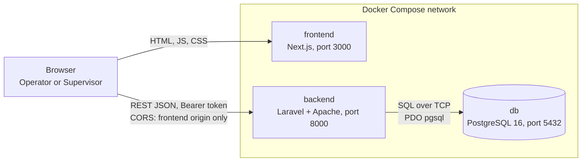
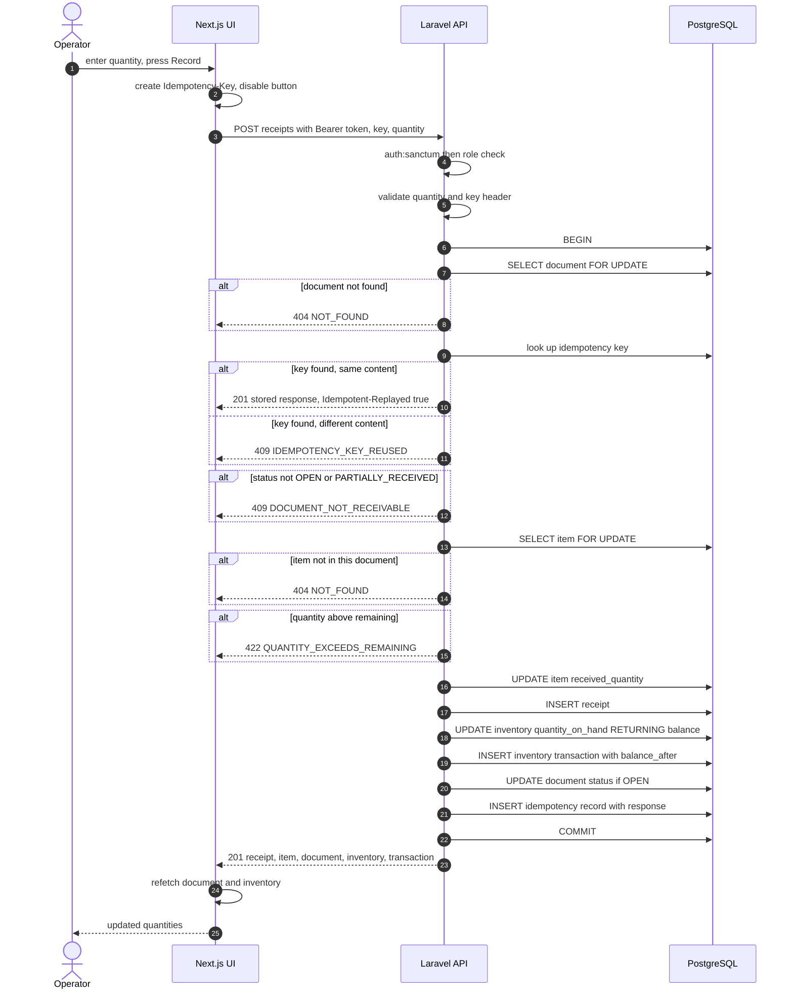
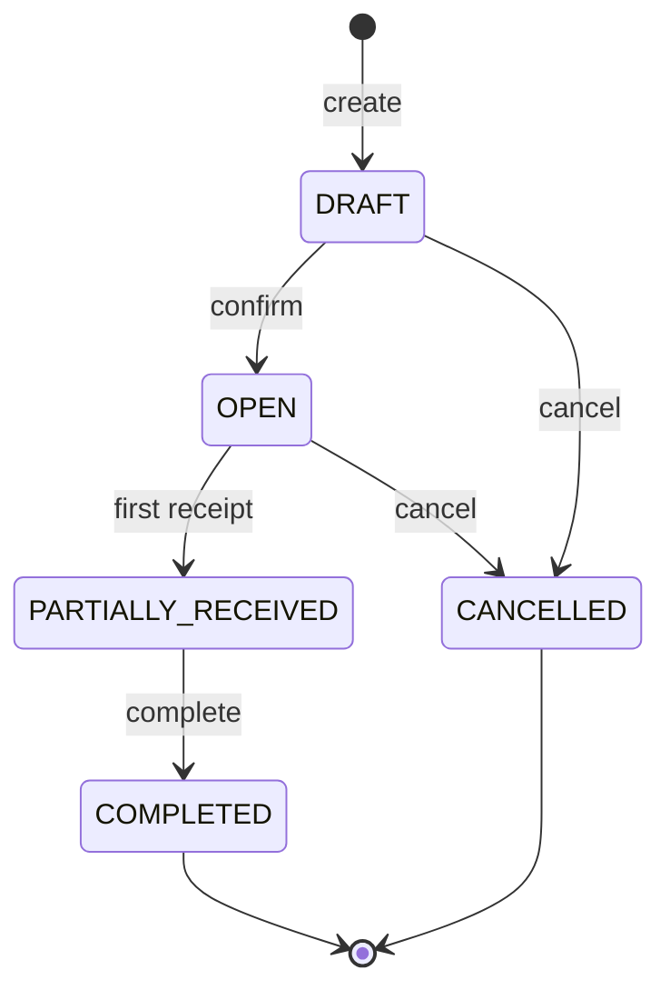

# Technical Specification: Warehouse Receiving System

| | |
|---|---|
| **Version** | 1.0 |
| **Status** | Draft for implementation |
| **Derived from** | `prd.md` v1.0 |
| **Companion artifacts** | `erd.mmd`, `database-design.md`, `openapi.yaml`, `data-flow.mmd` |
| **Audience** | Developers and AI coding agents |

> **How this document is used.** This is the primary input for implementation. The AI coding agent reads this file, the PRD, and the companion artifacts before writing code. If the code and this document ever disagree, **the document is updated first, then the code**. If something is not specified, the agent must stop and ask rather than invent behavior.
>
> **Source of truth by topic.** Business behavior: `prd.md`. Database schema, locking, and migrations: `database-design.md`. HTTP contract (endpoints, schemas, error codes): `openapi.yaml`. This document explains *how the parts fit together* and adds what the other files do not cover (architecture, code structure, authorization wiring, deployment, testing).

---

## 1. Overview and Technology Stack

### 1.1 Goal

Replace the warehouse's spreadsheets with a web application for registering inbound deliveries, recording partial and full receipts, updating stock automatically, and keeping an immutable history of every stock change. All business rules are enforced by the backend, and the most critical ones are repeated as database constraints.

### 1.2 Stack

| Layer | Choice | Notes |
|---|---|---|
| Backend | **Laravel** (latest stable major at project start), PHP 8.3 or newer | REST API, validation, Eloquent ORM, migrations, Sanctum tokens |
| Frontend | **Next.js** (latest stable major at project start), App Router, TypeScript | Browser UI that calls the API |
| UI styling | Tailwind CSS | No component library required |
| Frontend data fetching | TanStack Query with a small typed `fetch` client | Cache invalidation after mutations |
| Database | **PostgreSQL 16** | Row locks, `CHECK` constraints, triggers |
| Authentication | Laravel Sanctum personal access tokens (bearer) | A-15 |
| Backend tests | PHPUnit (Laravel feature and unit tests) against real PostgreSQL | Not SQLite: the design relies on PostgreSQL-specific constraints, triggers, and locks |
| Frontend tests | Vitest and React Testing Library (components), Playwright (end-to-end) | |
| Containers | Docker and Docker Compose | `db`, `backend`, `frontend` |
| API contract | OpenAPI 3.0.3 | `openapi.yaml` |

Exact versions are pinned in `composer.lock` and `package-lock.json` and listed in the README at the end of implementation. Do not use `latest` tags for container images.

### 1.3 Key design decisions

| # | Decision | Reason |
|---|---|---|
| D-1 | Two applications (Laravel API and Next.js UI) in one repository | Clear separation of responsibility; one history for the reviewer. |
| D-2 | The backend is the only place where business rules are decided | BR-24. The UI only guides the user. |
| D-3 | Stock is stored twice: `inventory.quantity_on_hand` (fast read) and `inventory_transactions` (ledger), written in one DB transaction | NFR-1, NFR-2, BR-17. |
| D-4 | Row locks in a fixed order (document, item, inventory) | NFR-3. Prevents over-receiving and deadlocks. |
| D-5 | Idempotency keys stored in the database | FR-RCV-6. No extra infrastructure. |
| D-6 | Role checks in route middleware, not in the UI | FR-AUTH-5. |
| D-7 | No implicit route-model binding for documents and items. Services load rows themselves, with locks. | Gives a fixed error precedence (Section 8.5) and makes locking explicit. |
| D-8 | Types in the frontend are generated from `openapi.yaml` | Prevents drift between frontend and backend. |
| D-9 | The browser calls the API directly, with CORS restricted to the frontend origin | NFR-6. |

---

## 2. System Architecture

### 2.1 Components



The browser loads the UI from `frontend`, then calls `backend` directly. The Next.js server does not proxy API calls and does not hold business logic. `db` is reachable only from `backend` inside the Compose network (the port may be published to `127.0.0.1` for local debugging).

### 2.2 Responsibilities

| Component | Responsibilities | Must not |
|---|---|---|
| **Next.js frontend** | Login, role-aware navigation, forms, tables, status badges, showing API errors, generating idempotency keys, keeping the token | Decide business rules, compute stock, trust its own validation |
| **Laravel API** | Authentication, role authorization, input validation, business rules, transactions and locking, error mapping, serialization | Render HTML, trust the client |
| **PostgreSQL** | Persistence, constraints, uniqueness, immutable ledger (triggers), row locks | Hold business workflow logic beyond constraints |

### 2.3 Backend layering

Request path inside Laravel, in order:

1. **Middleware**: `auth:sanctum` (401), then `role:...` (403).
2. **Form Request**: input validation (422). Normalization such as trimming and uppercasing SKU.
3. **Controller**: thin. Calls one service method, wraps the result in an API Resource. No business rules.
4. **Service**: business rules, state machine, transactions, locks. The only layer that writes to the database for business operations.
5. **Models and Enums**: Eloquent models, `Role`, `DocumentStatus`, `TransactionType`.
6. **Exception handler**: converts every exception into the standard error JSON.

Rules for the layers:

- Controllers never touch Eloquent for writes.
- Services never read from `Request` or return HTTP responses. They take plain values and return models or DTOs, and throw `ApiException` for rule violations.
- Only services open database transactions (`DB::transaction`).
- Database writes of the receiving operation happen only in `ReceivingService::recordReceipt`.

---

## 3. Repository Layout

```text
warehouse-receiving-system/
├── docs/
│   ├── prd.md
│   ├── technical-spec.md
│   ├── erd.mmd
│   ├── database-design.md
│   ├── openapi.yaml
│   ├── data-flow.mmd
│   ├── ai-workflow.md
│   └── testing.md
├── backend/                         Laravel application
│   ├── app/
│   │   ├── Enums/                   Role, DocumentStatus, TransactionType, ErrorCode
│   │   ├── Exceptions/              ApiException
│   │   ├── Http/
│   │   │   ├── Controllers/Api/V1/  AuthController, ProductController,
│   │   │   │                        ReceivingDocumentController, ReceiptController,
│   │   │   │                        InventoryController, InventoryTransactionController,
│   │   │   │                        HealthController
│   │   │   ├── Middleware/          EnsureRole
│   │   │   ├── Requests/            one Form Request per write endpoint and per list endpoint
│   │   │   └── Resources/           ProductResource, ReceivingDocumentResource, ...
│   │   ├── Models/                  User, Product, Inventory, ReceivingDocument, ReceivingItem,
│   │   │                            Receipt, InventoryTransaction, IdempotencyKey,
│   │   │                            DocumentNumberSequence
│   │   └── Services/                ProductService, ReceivingDocumentService,
│   │                                ReceivingService, DocumentNumberGenerator
│   ├── database/
│   │   ├── migrations/
│   │   └── seeders/                 UserSeeder, DemoDataSeeder
│   ├── routes/api.php
│   ├── tests/{Unit,Feature,Concurrency}/
│   ├── docker/entrypoint.sh
│   └── Dockerfile
├── frontend/                        Next.js application
│   ├── src/
│   │   ├── app/                     routes (App Router)
│   │   ├── components/
│   │   ├── lib/api/                 client.ts, types.ts (generated), idempotency.ts
│   │   └── lib/auth/                token storage, AuthProvider
│   ├── tests/e2e/                   Playwright
│   └── Dockerfile
├── .github/copilot-instructions.md  agent instructions
├── docker-compose.yml
├── .env.example
├── .gitignore
└── README.md
```

---

## 4. Backend Design

### 4.1 Routes and middleware

All routes are under `/api/v1` in `routes/api.php`. Do **not** call `statefulApi()` or enable cookie or session authentication: the API is token-only.

| Method and path | Middleware | Controller action |
|---|---|---|
| `GET /health` | none | `HealthController@show` |
| `POST /auth/login` | none | `AuthController@login` |
| `POST /auth/logout` | `auth:sanctum` | `AuthController@logout` |
| `GET /auth/me` | `auth:sanctum` | `AuthController@me` |
| `GET /products` | `auth:sanctum` | `ProductController@index` |
| `GET /products/{productId}` | `auth:sanctum` | `ProductController@show` |
| `POST /products` | `auth:sanctum`, `role:SUPERVISOR` | `ProductController@store` |
| `GET /receiving-documents` | `auth:sanctum` | `ReceivingDocumentController@index` |
| `GET /receiving-documents/{documentId}` | `auth:sanctum` | `ReceivingDocumentController@show` |
| `POST /receiving-documents` | `auth:sanctum`, `role:SUPERVISOR` | `ReceivingDocumentController@store` |
| `PUT /receiving-documents/{documentId}` | `auth:sanctum`, `role:SUPERVISOR` | `ReceivingDocumentController@update` |
| `POST /receiving-documents/{documentId}/confirm` | `auth:sanctum`, `role:SUPERVISOR` | `ReceivingDocumentController@confirm` |
| `POST /receiving-documents/{documentId}/complete` | `auth:sanctum`, `role:SUPERVISOR` | `ReceivingDocumentController@complete` |
| `POST /receiving-documents/{documentId}/cancel` | `auth:sanctum`, `role:SUPERVISOR` | `ReceivingDocumentController@cancel` |
| `POST /receiving-documents/{documentId}/items/{itemId}/receipts` | `auth:sanctum`, `role:OPERATOR,SUPERVISOR` | `ReceiptController@store` |
| `GET /inventory` | `auth:sanctum` | `InventoryController@index` |
| `GET /inventory-transactions` | `auth:sanctum` | `InventoryTransactionController@index` |

Path parameters are plain ids passed to services. The controller does not use route-model binding for documents, items, or products (D-7).

### 4.2 Services

| Service | Methods | Responsibility |
|---|---|---|
| `ProductService` | `create(name, sku, user)`, `list(filters)`, `find(id)` | Normalizes SKU, creates the product and its `inventory` row (stock 0) in one transaction (FR-PROD-5). Converts a unique violation on `products_sku_unique` into `SKU_ALREADY_EXISTS`. |
| `ReceivingDocumentService` | `create(data, user)`, `update(id, data)`, `confirm(id, user)`, `complete(id, user)`, `cancel(id, user)`, `list(filters)`, `find(id)` | Document lifecycle and the state machine. Every write method opens a transaction and **locks the document row first**. |
| `ReceivingService` | `recordReceipt(documentId, itemId, quantity, idempotencyKey, user)` | The main receiving operation, exactly as in Section 10. |
| `DocumentNumberGenerator` | `next(date)` | Atomic upsert into `document_number_sequences` (see `database-design.md` section 6.4). Runs inside the document-creation transaction. |

Read queries (`list`, `find`) avoid N+1 queries: eager load items with products, and compute `item_count`, `total_expected_quantity`, and `total_received_quantity` with aggregate subqueries (`withCount`, `withSum`).

### 4.3 State machine

Implemented once, in the `DocumentStatus` enum (or a small `DocumentStateMachine` class), and used by every lifecycle method. The transition table in Section 11 is the single definition. No service method compares status strings directly.

### 4.4 Error handling

One `ApiException` class carries `ErrorCode`, HTTP status, message, and optional `details`. Services throw it for rule violations. The global exception handler (configured in `bootstrap/app.php`) renders **every** exception under `/api/*` as:

```json
{ "error": { "code": "...", "message": "...", "details": { } } }
```

| Source | HTTP | Code |
|---|---|---|
| Missing, invalid, or revoked token; wrong login | 401 | `UNAUTHENTICATED` |
| `EnsureRole` rejection | 403 | `FORBIDDEN` |
| Row not found (`ModelNotFoundException`, or explicit not-found in a service), unknown route | 404 | `NOT_FOUND` |
| Laravel `ValidationException`. `details.fields` is a map of field to messages. | 422 | `VALIDATION_ERROR` |
| Duplicate product in a document | 422 | `DUPLICATE_PRODUCT_IN_DOCUMENT` |
| SKU already exists | 422 | `SKU_ALREADY_EXISTS` |
| Quantity above remaining | 422 | `QUANTITY_EXCEEDS_REMAINING` |
| Document not in `DRAFT` when editing | 409 | `DOCUMENT_NOT_EDITABLE` |
| Document not receivable | 409 | `DOCUMENT_NOT_RECEIVABLE` |
| Completing with unfinished items | 409 | `DOCUMENT_NOT_FULLY_RECEIVED` |
| Cancelling a document with receipts | 409 | `DOCUMENT_HAS_RECEIPTS` |
| Transition not allowed from current status | 409 | `INVALID_STATUS_TRANSITION` |
| Idempotency key reused with different content | 409 | `IDEMPOTENCY_KEY_REUSED` |
| Anything unexpected | 500 | `INTERNAL_ERROR` (generic message, stack trace only in the log) |

**Database constraint fallback.** A `UniqueConstraintViolationException` or `CheckViolationException` that slips past the service checks is mapped by constraint name:

| Constraint | Mapped to |
|---|---|
| `products_sku_unique` | `SKU_ALREADY_EXISTS` (422) |
| `receiving_items_document_product_unique` | `DUPLICATE_PRODUCT_IN_DOCUMENT` (422) |
| `receiving_items_not_over_received_check` | `QUANTITY_EXCEEDS_REMAINING` (422) |
| `idempotency_keys_scope_unique` | `IDEMPOTENCY_KEY_REUSED` (409) |
| Any other | `INTERNAL_ERROR` (500), logged |

Requests must be treated as JSON even if the client forgets `Accept: application/json`: the handler checks `$request->is('api/*')`, not `expectsJson()`.

Deadlocks and serialization failures are retried: `DB::transaction($callback, attempts: 3)` for write services.

### 4.5 Authentication details

- `POST /auth/login`: look up the user by `lower(email)`, verify the password with the Laravel hasher, create a Sanctum token with an expiry from `SANCTUM_TOKEN_EXPIRATION_MINUTES` (default 480). Wrong email and wrong password give the same `401 UNAUTHENTICATED` response and message, so the API does not reveal which one was wrong.
- `POST /auth/logout`: delete the current access token only.
- Passwords are hashed by Laravel's hasher. Tokens are stored hashed by Sanctum.
- Seeded users come from `UserSeeder` using environment variables (Section 14.2).

### 4.6 Serialization

- API Resources produce the exact shapes in `openapi.yaml`. Timestamps use `toIso8601ZuluString()`.
- `app.timezone` is `UTC`. The database connection timezone is UTC.
- List endpoints use `paginate($perPage)` and return `meta` with `page`, `per_page`, `total`, `last_page`.
- List query parameters are validated by a Form Request (`page`, `per_page` 1 to 100, `status` enum, `search` max 100 characters).

### 4.7 Health endpoint

`GET /api/v1/health` runs `SELECT 1`. On success: `200 {"status":"ok","database":"ok"}`. On any database exception: `503 {"status":"error","database":"unreachable"}`. It never returns a stack trace and requires no authentication.

---

## 5. Frontend Design

### 5.1 Routes

| Route | Page | Visible to |
|---|---|---|
| `/login` | Login form | Everyone |
| `/products` | Product list with search. "New product" form for Supervisors. | Both roles |
| `/receiving-documents` | Document list with status filter and search | Both roles |
| `/receiving-documents/new` | Create document form with an items editor | Supervisor |
| `/receiving-documents/[id]` | Document detail: header, items, receipt form, receipt history, lifecycle actions | Both roles |
| `/receiving-documents/[id]/edit` | Edit a draft document (same form component as create) | Supervisor |
| `/inventory` | Stock per product | Both roles |
| `/inventory/transactions` | Transaction history with product and document filters | Both roles |

Unauthenticated users are redirected to `/login`. A Supervisor-only route opened by an Operator redirects to `/receiving-documents` with a short message. This is a convenience: the backend independently returns 403.

### 5.2 Structure and conventions

- `lib/api/client.ts`: the only place that calls `fetch`. It adds the base URL (`NEXT_PUBLIC_API_URL`), `Accept` and `Content-Type` headers, and the `Authorization` header. It parses the standard error shape into a typed `ApiError { status, code, message, details }`. On `401` it clears the token and redirects to `/login`.
- `lib/api/types.ts` is **generated** from `openapi.yaml` with `openapi-typescript` (npm script `generate:api-types`). Do not edit it by hand.
- TanStack Query hooks per resource (`useProducts`, `useReceivingDocument`, `useRecordReceipt`, ...). Mutations invalidate the affected queries: a successful receipt invalidates the document detail, document list, inventory, and transactions.
- The token is kept in `localStorage` and mirrored in memory by the `AuthProvider`. Trade-off: it is readable by injected scripts (XSS). Mitigations: React escapes output, `dangerouslySetInnerHTML` is forbidden, and tokens expire (Section 4.5). This is recorded as a known limitation.
- No business rules are computed in the UI. `remaining_quantity` and `all_items_received` come from the API.

### 5.3 Role-aware actions

The UI reads `user.role` from `/auth/me`. It hides actions the role cannot perform and disables actions that are invalid for the document's status. This is only guidance (BR-24).

| Document status | Operator sees | Supervisor sees |
|---|---|---|
| `DRAFT` | Read-only detail | Edit, Confirm, Cancel |
| `OPEN` | Receive form per item | Receive form per item, Cancel |
| `PARTIALLY_RECEIVED` | Receive form for items with remaining quantity above 0 | Receive form, **Complete** (enabled only when `all_items_received` is true, with a "Ready to complete" indicator) |
| `COMPLETED` | Read-only detail and history | Read-only detail and history |
| `CANCELLED` | Read-only detail | Read-only detail |

"Cancel" is not shown for `PARTIALLY_RECEIVED` (BR-11).

### 5.4 Receipt form and idempotency keys (FR-UI-9)

- The quantity input accepts whole numbers from 1 up to the item's remaining quantity (client-side hint only).
- When the user presses "Record", the form creates a key with `crypto.randomUUID()` and keeps it in component state.
- While the request is in flight the button is disabled (prevents double-clicks).
- If the request ends **without a definitive answer** (network error, timeout, or 5xx), the form keeps the same key, so a retry is safe.
- If the request ends with a **definitive answer** (2xx or 4xx), the key is discarded. The next attempt creates a new key.
- Server errors are displayed with the API message. For `QUANTITY_EXCEEDS_REMAINING` the UI shows the `remaining_quantity` from `details`, then refetches the document.

### 5.5 UI states

Every page handles loading, empty, and error states. Forms show field-level errors from `details.fields` and a general alert for other error codes. No page may crash on an unexpected error code: unknown codes show the message from the API.

---

## 6. Database Design

The complete design lives in **`database-design.md`**: DDL, indexes, constraints, locking, migration order, seeding, and integrity queries. The summary:

- 10 tables: `users`, `personal_access_tokens`, `products`, `inventory`, `document_number_sequences`, `receiving_documents`, `receiving_items`, `receipts`, `inventory_transactions`, `idempotency_keys`.
- Critical rules are also database constraints: unique SKU, `received_quantity <= expected_quantity`, non-negative stock, one transaction per receipt, unique idempotency scope.
- `receipts` and `inventory_transactions` are append-only (triggers).
- Locks are always taken in the order document, item, inventory.
- Migrations: one per table, explicit constraint names, working `down()`, run by the backend container entrypoint with `php artisan migrate --force`. Seeders are idempotent.

## 7. ERD

The entity relationship diagram is in **`erd.mmd`** (Mermaid `erDiagram`). Relationships:

- `users` 1:N `products`, `receiving_documents`, `receipts`, `inventory_transactions`, `idempotency_keys`, `personal_access_tokens`
- `products` 1:1 `inventory`; `products` 1:N `receiving_items`, `inventory_transactions`
- `receiving_documents` 1:N `receiving_items`; `receiving_documents` 1:N `inventory_transactions`
- `receiving_items` 1:N `receipts`
- `receipts` 1:1 `inventory_transactions`; `receipts` 1:0..1 `idempotency_keys`

---

## 8. API Contract

The contract is **`openapi.yaml`** (OpenAPI 3.0.3, 17 operations). It defines every endpoint, request and response schema, validation constraint, and error example. Implementation must match it; contract changes are made in the file first.

### 8.1 Endpoint summary

| Area | Endpoints |
|---|---|
| Health | `GET /health` |
| Auth | `POST /auth/login`, `POST /auth/logout`, `GET /auth/me` |
| Products | `GET /products`, `POST /products`, `GET /products/{productId}` |
| Receiving documents | `GET /receiving-documents`, `POST /receiving-documents`, `GET /receiving-documents/{documentId}`, `PUT /receiving-documents/{documentId}`, `POST .../confirm`, `POST .../complete`, `POST .../cancel` |
| Receipts | `POST /receiving-documents/{documentId}/items/{itemId}/receipts` |
| Inventory | `GET /inventory`, `GET /inventory-transactions` |

### 8.2 Conventions

Bearer authentication, JSON only, `data` and `meta` envelopes, `page` and `per_page` (default 20, maximum 100), ISO 8601 UTC timestamps. Full list in the `info.description` of `openapi.yaml`.

### 8.3 Validation

Field-level rules are in PRD section 8.2 and repeated as constraints in `openapi.yaml`. The Form Requests implement them. Summary of normalization performed **before** validation: `sku` trimmed and uppercased, `name` and `supplier_name` trimmed.

### 8.4 Error responses

One shape, stable codes, defined in PRD section 8.5 and mapped to HTTP statuses in Section 4.4 above.

### 8.5 Error precedence

When several things are wrong at once, the API reports the first failing check in this order, so behavior is deterministic and testable:

1. **401** Not authenticated
2. **403** Role not permitted
3. **422** Input validation (including a missing `Idempotency-Key`)
4. **404** Resource does not exist (document, then item)
5. **409 / 422** State and business rules, in the order of Section 10 (idempotency replay, status, remaining quantity)

Example: an Operator calling `POST /products` with an invalid body gets 403, not 422. A valid-looking request to a nonexistent document gets 404.

---

## 9. Data Flow

The data flow diagram is **`data-flow.mmd`**. It shows how information moves between the users, the Next.js frontend, the Laravel API pipeline, and the PostgreSQL tables. Numbered edges follow the receiving workflow.

Flows at a glance:

| Flow | Data in | Processing | Data stored or returned |
|---|---|---|---|
| **Login** | Email, password | Verify hash, create token | `personal_access_tokens` row; token and user returned |
| **Create product** | SKU, name | Normalize, validate, unique check, one transaction | `products` row and `inventory` row (stock 0) |
| **Create document** | Supplier, date, notes, items | Validate, duplicate-product check, next number, one transaction | `receiving_documents` (`DRAFT`), `receiving_items`, counter row |
| **Edit draft** | Same as create | Lock document, require `DRAFT`, replace items | Updated header and items |
| **Confirm, complete, cancel** | Document id | Lock document, apply state machine and conditions | New status, `status_changed_by`, `status_changed_at` |
| **Record receipt** | Document id, item id, quantity, idempotency key | Section 10 | Item, receipt, ledger row, stock, document status, idempotency record |
| **Read lists and details** | Filters, pagination | Query with aggregates and joins | JSON with `data` and `meta` |

Data that never leaves the backend: password hashes, token hashes, request hashes. Data derived by the backend and never computed by the frontend: `remaining_quantity`, `all_items_received`, `balance_after`, `item_count`, totals.

---

## 10. API Flow: Receiving Workflow

### 10.1 End-to-end business workflow

1. Supervisor creates products (once, as needed): `POST /products`.
2. Supervisor creates a document with items: `POST /receiving-documents` (status `DRAFT`). May edit with `PUT` while in `DRAFT`.
3. Supervisor confirms: `POST .../confirm` (`DRAFT` to `OPEN`).
4. Goods arrive. Operator records receipts per item: `POST .../items/{itemId}/receipts`, once or many times. The first receipt moves the document to `PARTIALLY_RECEIVED`.
5. When every item is fully received, the UI shows "Ready to complete". Supervisor completes: `POST .../complete` (`PARTIALLY_RECEIVED` to `COMPLETED`).
6. Anyone can view stock (`GET /inventory`) and history (`GET /inventory-transactions`) at any time.

### 10.2 Recording a receipt: sequence



Every early exit above rolls the transaction back, so a rejected request changes nothing (BR-14).

### 10.3 Step-by-step processing (authoritative)

`ReceivingService::recordReceipt` implements these steps inside `DB::transaction(..., attempts: 3)`. They match `database-design.md` section 6.3.

| Step | Action | On failure |
|---|---|---|
| 0 | Before the transaction: middleware has authenticated the user and checked the role. The Form Request has validated `quantity` (integer, at least 1) and the `Idempotency-Key` header (8 to 128 characters). | 401, 403, or 422 `VALIDATION_ERROR` |
| 1 | `SELECT ... FROM receiving_documents WHERE id = :doc FOR UPDATE` | 404 `NOT_FOUND` |
| 2 | Look up `(user_id, 'receipts.store', key)` in `idempotency_keys`. Request hash is `sha256` of `{document_id, item_id, quantity}`. Same hash: return the stored response. Different hash: reject. | 409 `IDEMPOTENCY_KEY_REUSED` |
| 3 | Require document status `OPEN` or `PARTIALLY_RECEIVED` | 409 `DOCUMENT_NOT_RECEIVABLE` |
| 4 | `SELECT ... FROM receiving_items WHERE id = :item AND receiving_document_id = :doc FOR UPDATE` | 404 `NOT_FOUND` |
| 5 | `remaining = expected_quantity - received_quantity`. Require `quantity <= remaining`. | 422 `QUANTITY_EXCEEDS_REMAINING` with `remaining_quantity` and `requested_quantity` |
| 6 | `UPDATE receiving_items SET received_quantity = received_quantity + :q` | |
| 7 | `INSERT INTO receipts` (item, quantity, user) | |
| 8 | `UPDATE inventory SET quantity_on_hand = quantity_on_hand + :q WHERE product_id = :p RETURNING quantity_on_hand` | |
| 9 | `INSERT INTO inventory_transactions` (type `RECEIVE`, quantity, `balance_after` from step 8, receipt, item, document, product, user) | |
| 10 | If status is `OPEN`: set `PARTIALLY_RECEIVED`, `status_changed_by`, `status_changed_at` | |
| 11 | Build the response (receipt, item, document summary with `all_items_received`, inventory, transaction). `INSERT INTO idempotency_keys` with status 201 and the response body. | |
| 12 | Commit and return 201 | |

Notes:

- `all_items_received` is computed after step 6 with a query on the document's items.
- A replay (step 2) returns the stored body unchanged with header `Idempotent-Replayed: true`, even if the document has since become `COMPLETED`.
- If a unique violation on `idempotency_keys_scope_unique` happens at step 11 (same key used concurrently for two different documents), the transaction is rolled back and the API returns 409 `IDEMPOTENCY_KEY_REUSED`.

### 10.4 Other write flows

**Create document** (`ReceivingDocumentService::create`), one transaction: validate; check duplicate `product_id` values (`DUPLICATE_PRODUCT_IN_DOCUMENT`); generate the number with the sequence upsert; insert the document with `DRAFT` and `created_by`; insert items with `received_quantity` 0; return the detail.

**Edit draft**: lock the document; require `DRAFT` (`DOCUMENT_NOT_EDITABLE`); update the header; delete all items and insert the new list (safe because a draft has no receipts; the foreign key from `receipts` would block deletion otherwise).

**Confirm**: lock; require `DRAFT` (`INVALID_STATUS_TRANSITION`); the document has at least one item by construction; set `OPEN`, `status_changed_by`, `status_changed_at`.

**Complete**: lock; require `PARTIALLY_RECEIVED` (`INVALID_STATUS_TRANSITION`); require no item with `received_quantity < expected_quantity` (`DOCUMENT_NOT_FULLY_RECEIVED`, with `incomplete_items` in details); set `COMPLETED`.

**Cancel**: lock; if `PARTIALLY_RECEIVED` return `DOCUMENT_HAS_RECEIPTS`; if not `DRAFT` or `OPEN` return `INVALID_STATUS_TRANSITION`; set `CANCELLED`.

---

## 11. State Transitions



### 11.1 Transition table (single definition)

| From | Action | To | Actor | Guard | Failure |
|---|---|---|---|---|---|
| (none) | create | `DRAFT` | Supervisor | Valid input | 422 |
| `DRAFT` | confirm | `OPEN` | Supervisor | At least one item | 409 `INVALID_STATUS_TRANSITION` if not `DRAFT` |
| `DRAFT` | cancel | `CANCELLED` | Supervisor | none | |
| `OPEN` | receive (first) | `PARTIALLY_RECEIVED` | System, triggered by Operator or Supervisor | Receipt succeeds | |
| `OPEN` | cancel | `CANCELLED` | Supervisor | none | |
| `PARTIALLY_RECEIVED` | receive (further) | `PARTIALLY_RECEIVED` | Operator or Supervisor | Receipt succeeds | |
| `PARTIALLY_RECEIVED` | complete | `COMPLETED` | Supervisor | Every item fully received | 409 `DOCUMENT_NOT_FULLY_RECEIVED` |
| `PARTIALLY_RECEIVED` | cancel | not allowed | | | 409 `DOCUMENT_HAS_RECEIPTS` |
| `DRAFT`, `OPEN` | complete | not allowed | | | 409 `INVALID_STATUS_TRANSITION` |
| `COMPLETED`, `CANCELLED` | any | not allowed | | Final states | 409 |

### 11.2 Rules

- The check happens **after** locking the document row, so two concurrent actions on the same document cannot both succeed.
- A document stays in `PARTIALLY_RECEIVED` after the last item is fully received, until a Supervisor completes it (BR-09). `all_items_received` tells the UI when completion is possible.
- Transitions cause the document's `status_changed_by` and `status_changed_at` to be set. For the automatic `OPEN` to `PARTIALLY_RECEIVED` change, they record the user whose receipt triggered it.

---

## 12. Authorization

### 12.1 Model

- Two roles: `OPERATOR` and `SUPERVISOR`, one per user (A-02), stored in `users.role`.
- Authorization is enforced by the `EnsureRole` middleware on routes (Section 4.1). No role logic lives in controllers or services, except that `status_changed_by` and `created_by` are recorded from the authenticated user.
- A failed role check returns `403 FORBIDDEN` before validation and before any database lookup of the resource.

### 12.2 Permission matrix

| Action | Operator | Supervisor | Endpoint |
|---|---|---|---|
| Log in | Yes | Yes | `POST /auth/login` |
| Log out, view own profile | Yes | Yes | `POST /auth/logout`, `GET /auth/me` |
| List and view products | Yes | Yes | `GET /products`, `GET /products/{id}` |
| Create product | **No** | Yes | `POST /products` |
| List and view documents | Yes | Yes | `GET /receiving-documents`, `GET .../{id}` |
| Create document | **No** | Yes | `POST /receiving-documents` |
| Edit draft document | **No** | Yes | `PUT /receiving-documents/{id}` |
| Confirm document | **No** | Yes | `POST .../confirm` |
| Record receipt | Yes | Yes | `POST .../items/{itemId}/receipts` |
| Complete document | **No** | Yes | `POST .../complete` |
| Cancel document | **No** | Yes | `POST .../cancel` |
| View inventory | Yes | Yes | `GET /inventory` |
| View transaction history | Yes | Yes | `GET /inventory-transactions` |

### 12.3 Authentication rules

- All routes except `POST /auth/login` and `GET /health` require a valid token.
- A revoked (logged out) or expired token returns `401`.
- The token's abilities are not used; the role is read from the user record on every request, so a role change in the database takes effect immediately.

---

## 13. Security and Non-Functional Implementation

| Requirement | Implementation |
|---|---|
| NFR-1, NFR-2 | Receipt, ledger, stock, and status change in one transaction (Section 10.3). |
| NFR-3 | Row locks in the fixed order; unique constraints; `CHECK` constraints; deadlock retry. |
| NFR-4 | Constraints listed in `database-design.md` section 7. |
| NFR-5 | Hashed passwords and tokens; `.env` is git-ignored; `.env.example` has placeholders only. |
| NFR-6 | CORS configured from `CORS_ALLOWED_ORIGINS`; only that origin, no wildcard; allowed headers include `Authorization`, `Content-Type`, `Accept`, `Idempotency-Key`; exposed headers include `Idempotent-Replayed`. |
| NFR-7 | Form Requests validate everything; `APP_DEBUG=false` outside local development; generic 500 message. |
| NFR-8 | Pagination limits; indexes from `database-design.md`; eager loading and aggregate subqueries. |
| NFR-9 | Entrypoint runs migrations; seeders are idempotent; one documented start command. |
| NFR-10 | Health endpoint; errors logged to `stderr` so `docker compose logs` shows them. |
| NFR-11 | `openapi.yaml`; one error handler. |
| NFR-12 | Responsive Tailwind layout; tables scroll horizontally on small screens. |
| NFR-13 | Layering rules (Section 2.3). |
| NFR-14 | Testing strategy (Section 15). |
| NFR-15 | Environment variables (Section 14.2). |
| NFR-16 | UTC everywhere; ISO 8601 output. |

SQL injection is avoided by using Eloquent and the query builder with bindings only. Mass assignment is restricted with explicit `$fillable` lists. The frontend never uses `dangerouslySetInnerHTML`.

---

## 14. Deployment and Configuration

### 14.1 Containers

| Service | Image and build | Port | Notes |
|---|---|---|---|
| `db` | `postgres:16-alpine` (pinned tag) | 5432 (internal; optionally published to `127.0.0.1`) | Named volume `pgdata`. Healthcheck: `pg_isready`. |
| `backend` | Multi-stage `backend/Dockerfile`: Composer install stage, then `php:8.3-apache` runtime with `pdo_pgsql` | 8000 to container 80 | Apache document root `public/`. Runs as `www-data`. Entrypoint described below. |
| `frontend` | Multi-stage `frontend/Dockerfile`: install, build with `output: 'standalone'`, run `node server.js` | 3000 | `NEXT_PUBLIC_API_URL` is baked in at **build time** (build argument). |

`docker-compose.yml`: `backend` depends on `db` with `condition: service_healthy`. `frontend` depends on `backend` with `condition: service_healthy`. Each service has a `healthcheck` (backend: `curl -f http://localhost/api/v1/health`).

**Backend entrypoint** (`docker/entrypoint.sh`):

1. Fail if `APP_KEY` is empty.
2. `php artisan migrate --force`.
3. If `RUN_SEEDERS=true`: `php artisan db:seed --force` (`UserSeeder`; `DemoDataSeeder` only if `SEED_DEMO_DATA=true`).
4. `php artisan config:cache` and `route:cache` when `APP_ENV=production`.
5. `exec apache2-foreground`.

Only one `backend` instance runs migrations (see `database-design.md` section 8.3).

### 14.2 Environment variables

All configuration comes from the environment. `.env.example` lists every variable below with placeholder values. `.env` is never committed.

| Variable | Service | Purpose | Example in `.env.example` |
|---|---|---|---|
| `POSTGRES_DB` | db | Database name | `warehouse` |
| `POSTGRES_USER` | db | Database user | `warehouse` |
| `POSTGRES_PASSWORD` | db | Database password | `password123` |
| `APP_NAME` | backend | Application name | `Warehouse Receiving` |
| `APP_ENV` | backend | `local` or `production` | `local` |
| `APP_KEY` | backend | Laravel key (generate; never commit) | empty |
| `APP_DEBUG` | backend | Debug mode | `false` |
| `APP_URL` | backend | Public API URL | `http://localhost:8000` |
| `APP_TIMEZONE` | backend | Must be UTC | `UTC` |
| `DB_CONNECTION` | backend | Driver | `pgsql` |
| `DB_HOST` | backend | Host | `db` |
| `DB_PORT` | backend | Port | `5432` |
| `DB_DATABASE` | backend | Same as `POSTGRES_DB` | `warehouse` |
| `DB_USERNAME` | backend | Same as `POSTGRES_USER` | `warehouse` |
| `DB_PASSWORD` | backend | Same as `POSTGRES_PASSWORD` | `change-me` |
| `CORS_ALLOWED_ORIGINS` | backend | Frontend origin(s), comma separated | `http://localhost:3000` |
| `SANCTUM_TOKEN_EXPIRATION_MINUTES` | backend | Token lifetime | `480` |
| `LOG_CHANNEL` | backend | Log target | `stderr` |
| `LOG_LEVEL` | backend | Log level | `info` |
| `RUN_SEEDERS` | backend | Seed users on start | `true` |
| `SEED_DEMO_DATA` | backend | Also seed demo products and a document | `false` |
| `SEED_SUPERVISOR_EMAIL` / `SEED_SUPERVISOR_PASSWORD` | backend | Demo Supervisor account | `supervisor@example.com` / `change-me-supervisor` |
| `SEED_OPERATOR_EMAIL` / `SEED_OPERATOR_PASSWORD` | backend | Demo Operator account | `operator@example.com` / `change-me-operator` |
| `NEXT_PUBLIC_API_URL` | frontend (build arg) | API base URL as seen by the browser | `http://localhost:8000/api/v1` |

The seeded demo passwords are placeholders for local use only and must be changed for any shared deployment. `.env.example` does not contain real secrets.

### 14.3 Start from a clean environment

```text
git clone <repository> && cd warehouse-receiving-system
cp .env.example .env
docker compose run --rm backend php artisan key:generate --show     # copy the value into .env as APP_KEY
docker compose up --build
```

Then: frontend at `http://localhost:3000`, API at `http://localhost:8000/api/v1`, health at `http://localhost:8000/api/v1/health`. `docker compose down -v` removes the database volume for a fully clean restart. The README documents these steps and the demo accounts.

---

## 15. Testing Strategy

Detailed evidence and results go in `testing.md`. This section defines what must exist.

### 15.1 Principles

- Backend tests run against **PostgreSQL** (a `postgres` service in Compose or CI), never SQLite, because the design depends on `CHECK` constraints, triggers, and row locks.
- Every rule marked **bold** in the PRD (BR-07, BR-08) and every business rule listed in PRD section 12 has at least one automated test.
- Tests assert **both** the response and the database state (rejected operations must change nothing).
- Test names reference requirement IDs, for example `test_br07_receipt_above_remaining_is_rejected`.

### 15.2 Unit tests (fast, no HTTP)

| Target | Cases |
|---|---|
| `DocumentStatus` transition table | Every allowed transition passes; every other pair is rejected (full matrix of 5 by 5 actions). |
| SKU normalization and format | Trim, uppercase, accepted and rejected patterns (leading or trailing hyphen, 51 characters, symbols). |
| Document number formatting | `RCV-YYYYMMDD-NNNN` padding, rollover beyond 9999. |
| Remaining quantity calculation | `expected - received`, boundary values. |
| Idempotency request hash | Same content gives the same hash, different quantity or item gives a different hash. |
| `ApiException` and error mapping | Constraint name to error code mapping. |

### 15.3 Integration tests (Laravel feature tests, real PostgreSQL)

| Area | Cases (requirement IDs) |
|---|---|
| **Auth** | Login success and failure (US-01); logout revokes token; protected route without token gives 401 (FR-AUTH-4); expired token gives 401. |
| **Authorization matrix** | A data-provider test calls every endpoint as Operator and Supervisor and asserts the matrix in Section 12.2, including 403 before 422 (Section 8.5). (BR-18, FR-AUTH-5) |
| **Products** | Create with normalization; duplicate SKU in different case gives 422 `SKU_ALREADY_EXISTS` (BR-01); inventory row created with stock 0 (FR-PROD-5); validation errors; search and pagination. |
| **Documents** | Create with items; zero items, duplicate product, missing product, bad quantity all give 422 (BR-02, BR-03, BR-04); number format and uniqueness; edit only in `DRAFT` (BR-05); list filters; detail contains items and receipts. |
| **Lifecycle** | Every row of the transition table in Section 11.1, with status and `status_changed_*` assertions (BR-09 to BR-12). |
| **Receiving** | Partial then full receipt updates item, stock, ledger, status (BR-10, BR-13); receipt above remaining gives 422 and changes nothing (BR-07, BR-14); zero, negative, decimal quantity; wrong item for document gives 404; receipts on `DRAFT`, `COMPLETED`, `CANCELLED` give 409 (BR-06). |
| **Idempotency** | Same key replays the stored response with `Idempotent-Replayed` and no stock change; same key with different quantity gives 409; missing key gives 422; failed request then corrected request with new key succeeds (US-10, BR-15). |
| **Completion rules** | Complete with remaining quantity gives 409 `DOCUMENT_NOT_FULLY_RECEIVED`; complete after full receipt succeeds (BR-08). Cancel after first receipt gives 409 (BR-11). |
| **Inventory and history** | Listing; filters by product and document; ordering newest first; no mutating endpoints exist (405 or 404) (BR-16). |
| **Database protection** | Direct SQL inserts or updates that violate each `CHECK`, unique, and foreign key constraint are rejected; `UPDATE` and `DELETE` on `receipts` and `inventory_transactions` raise the append-only exception (NFR-4, BR-16). |
| **Integrity after scenarios** | After a mixed scenario (several documents, partial and full receipts, rejected and replayed requests) run the verification queries from `database-design.md` section 9; every query returns zero rows (BR-17, NFR-1). |
| **Health** | 200 when the database is up; 503 when the connection is made to fail. |
| **Contract** | Responses of the main endpoints validate against `openapi.yaml` (recommended: a schema-validation helper in feature tests). |

### 15.3.1 Concurrency tests (`tests/Concurrency`)

These tests cannot run inside the usual per-test transaction, because other processes would not see uncommitted data. They use committed fixtures and clean up with a truncate.

| Scenario | Method | Expected result |
|---|---|---|
| Two receipts of 5 for an item with remaining 5, different keys | Start 2 or more processes (`Process::pool` running an artisan test command or script) that call `ReceivingService::recordReceipt` in separate DB connections at the same time | Exactly one succeeds, the other gets `QUANTITY_EXCEEDS_REMAINING`; received equals expected; stock and ledger consistent (US-11) |
| Same idempotency key sent twice at once | Same as above with identical key and content | One receipt is recorded, both callers get the same response body |
| Receipt versus cancel or complete at the same time | Two processes: record the first receipt on an `OPEN` document, and cancel the same document | Either the cancel wins (the receipt gets `DOCUMENT_NOT_RECEIVABLE`) or the receipt wins (the cancel gets `DOCUMENT_HAS_RECEIPTS`); never both |
| Many receipts on different items of the same product | N parallel receipts | Final stock equals the sum of accepted receipts; no deadlock errors surface |

A shell script (`scripts/concurrency-demo.sh`) sends parallel `curl` requests to the running Compose stack and prints before and after stock. This is the demonstration used as evidence in `testing.md`.

### 15.4 Frontend tests

| Level | Tool | Cases |
|---|---|---|
| Unit and component | Vitest and React Testing Library | API client maps the error shape; idempotency key is reused after a network error and replaced after a 4xx or 2xx (FR-UI-9); `ReceiptForm` blocks double submission and shows `QUANTITY_EXCEEDS_REMAINING` details; role-aware buttons per status (Section 5.3). |
| End-to-end | Playwright against the Compose stack | See below. |

**End-to-end scenarios** (data created through the UI or a seed):

1. Supervisor logs in, creates a product and a document with two items, confirms it.
2. Operator logs in, records a partial receipt, sees updated remaining quantity, and sees the document as `PARTIALLY_RECEIVED`.
3. Operator tries to receive more than the remaining quantity and sees a clear error; quantities are unchanged.
4. Supervisor tries to complete while an item is unfinished: the button is disabled, and if forced through the API the response is 409.
5. Operator completes the receipts; "Ready to complete" appears; Supervisor completes the document.
6. Inventory page shows the correct stock; transactions page lists each receipt with the right balance.
7. Operator does not see Create or Complete controls; a direct API call returns 403.
8. Double-click on "Record" results in a single receipt.

### 15.5 Quality gates

- Backend: Laravel Pint (code style) and the full PHPUnit suite pass.
- Frontend: ESLint, TypeScript `tsc --noEmit`, Vitest pass.
- `openapi.yaml` validates with an OpenAPI validator.
- The Compose stack starts from a clean checkout and the Playwright suite passes against it.
- Optional: a GitHub Actions workflow running the backend and frontend suites with a `postgres` service.

---

## 16. Implementation Plan for the AI Agent

Work is done in small tasks, one task per agent session or prompt. Each task has inputs (documents to read), an outcome, and verification. After each task the developer reviews the diff, runs the tests, and commits. Prompts and results are recorded in `ai-workflow.md`.

| Task | Scope | Read first | Done when |
|---|---|---|---|
| **T0** Skeleton | Repo layout, Laravel and Next.js projects, Dockerfiles, Compose, `.env.example`, `.gitignore`, health endpoint | This document sections 3, 14; `openapi.yaml` `/health` | `docker compose up --build` starts three healthy services; `/health` returns 200. |
| **T1** Database | All migrations in the order of `database-design.md` section 8.2, including constraints, indexes, triggers; models and enums | `database-design.md` sections 4, 8 | `migrate:fresh` succeeds; constraint tests from Section 15.3 "Database protection" pass. |
| **T2** Auth and errors | Sanctum login, logout, me; `EnsureRole`; `ApiException`; global error handler; `UserSeeder` | Sections 4.4, 4.5, 8.5, 12; PRD US-01 | Auth tests and authorization-matrix skeleton pass; every error uses the standard shape. |
| **T3** Products | Product service, endpoints, resources, tests | PRD US-02, US-03; `openapi.yaml` products | Product tests pass. |
| **T4** Documents | `DocumentNumberGenerator`, create, list, detail, edit | PRD US-04 to US-07; `database-design.md` 6.4 | Document tests pass; numbers unique under parallel creation. |
| **T5** Lifecycle | State machine, confirm, complete, cancel | Section 11; PRD US-08, US-12, US-13 | Full transition matrix tests pass. |
| **T6** Receiving | `ReceivingService::recordReceipt`, idempotency, inventory and transaction endpoints | Section 10; `database-design.md` 6.1 to 6.3; PRD US-09 to US-11, US-14, US-15 | Receiving and idempotency tests pass; integrity queries return zero rows. |
| **T7** Backend hardening | Concurrency tests and demo script, contract checks, Pint, README backend part | Section 15.3.1 | Concurrency scenarios pass repeatedly; evidence captured for `testing.md`. |
| **T8** Frontend foundation | API client, generated types, `AuthProvider`, layout, login, route guards | Sections 5.1, 5.2 | Login works for both roles; navigation reflects the role. |
| **T9** Frontend features | Products, documents (list, create, edit, detail), receipt form, lifecycle actions, inventory, transactions | Sections 5.3 to 5.5; PRD FR-UI-* | All pages usable end to end against the API. |
| **T10** Quality and delivery | Frontend and E2E tests, full Compose run from a clean clone, README, `testing.md`, `ai-workflow.md`, known limitations | Section 15 | All gates in 15.5 pass; documentation complete. |

Rules for every task:

1. Read the listed sections before writing code; cite requirement IDs in code comments and test names.
2. Do not add features outside PRD section 4.1.
3. Do not weaken or delete a test to make it pass; report the conflict instead.
4. When behavior is not specified, ask; do not guess.
5. Keep commits small with meaningful messages (`feat(backend): ...`, `test(backend): ...`, `docs: ...`).

---

## 17. Traceability Matrix

| PRD requirements | Implemented in (this document) | Verified by (Section 15) |
|---|---|---|
| FR-AUTH-1 to FR-AUTH-6 | 4.5, 12, 14.2 | Auth, authorization matrix |
| FR-PROD-1 to FR-PROD-5 | 4.2 `ProductService`, `database-design.md` | Products, database protection |
| FR-DOC-1 to FR-DOC-10 | 4.2 `ReceivingDocumentService`, 10.4 | Documents |
| FR-LIFE-1 to FR-LIFE-6 | 4.3, 11 | Lifecycle, unit transition matrix |
| FR-RCV-1 to FR-RCV-8 | 10 | Receiving, idempotency, concurrency |
| FR-INV-1 to FR-INV-5 | 4.2, 10.3 steps 8 and 9, append-only triggers | Inventory and history, database protection |
| FR-UI-1 to FR-UI-9 | 5 | Frontend tests, E2E |
| FR-OPS-1, FR-OPS-2 | 4.7, 14.1, `database-design.md` 8 | Health, clean-start check |
| NFR-1 to NFR-4 | 10.3, `database-design.md` 6, 7 | Integrity, concurrency, database protection |
| NFR-5 to NFR-7 | 4.4, 4.5, 13 | Auth, validation, error tests |
| NFR-8 to NFR-16 | 13, 14 | Quality gates |
| BR-01 to BR-24 | Sections 4 to 12 and `database-design.md` section 7 | Section 15.3 (each BR has at least one test) |
| US-01 to US-16 | Sections 5, 10, 11, 12 | Integration and E2E scenarios |

---

## 18. Trade-offs, Risks, and Known Limitations

| Topic | Note |
|---|---|
| Token in `localStorage` | Convenient but exposed to XSS. A cookie-based session through a Next.js backend-for-frontend would be safer but adds a layer. Accepted for this scope. |
| Document-level lock | Receipts on one document run one at a time. Safe and simple; throughput is not a concern for a receiving dock. |
| Idempotency table growth | No cleanup job. After a retention period old keys could be removed (see `database-design.md` section 11). |
| No stock correction or receipt reversal | A wrong quantity cannot be fixed in this version (PRD Q-02). |
| Short deliveries cannot be closed | A document with a missing remainder stays `PARTIALLY_RECEIVED` (PRD Q-01). |
| `NEXT_PUBLIC_API_URL` baked at build time | Changing the API URL requires rebuilding the frontend image. |
| Single backend instance | Migrations run in the entrypoint. Scaling out would require a separate migration job. |
| No rate limiting on login | Not required by the PRD. Recommended before production use. |
| Search uses `ILIKE '%term%'` | Fine for the stated volume; add a trigram index if it grows. |

With more time: receipt reversal and stock adjustments with approval, short-close with supervisor sign-off, a refresh-token or cookie-based session, a cleanup job for idempotency keys, CI pipeline, and role and user management.
